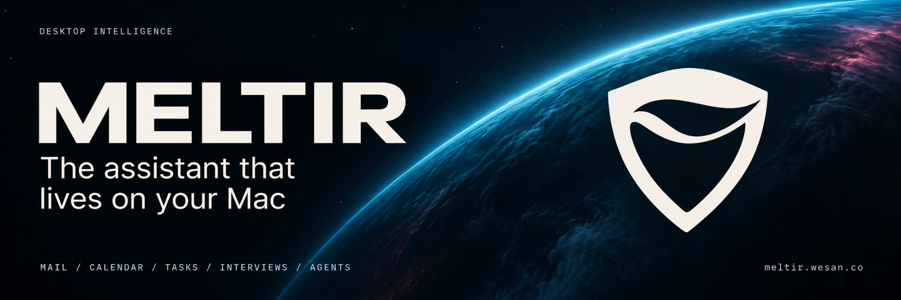
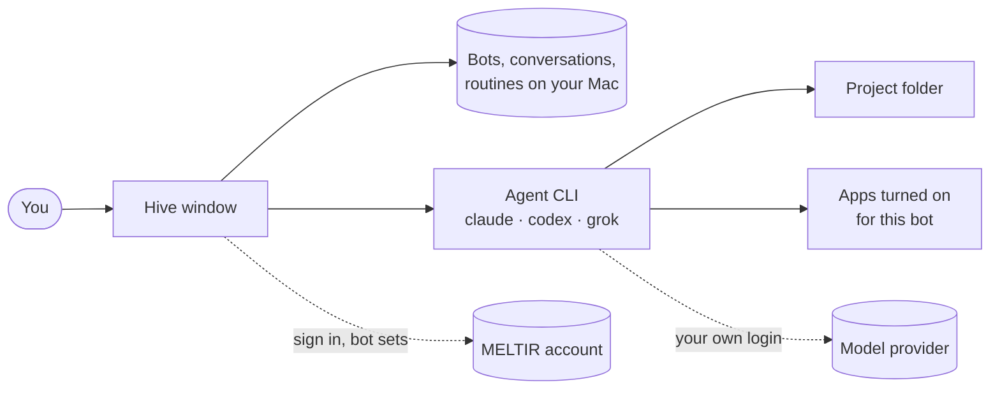

# MELTIR Hive

**A team of AI agents on your Mac, run like a messaging app.**

Each bot is a real coding agent with its own name, instructions, project, apps and schedule.
You talk to them like contacts, watch them work, and approve what matters.

[**Download**](https://github.com/canakyuz/meltir-releases/releases/latest) &nbsp;·&nbsp; [Get access](#get-access) &nbsp;·&nbsp; [Set up an engine](#set-up-an-engine) &nbsp;·&nbsp; [Troubleshooting](#troubleshooting) &nbsp;·&nbsp; [meltir.wesan.co](https://meltir.wesan.co)

---

## Contents

- [Why Hive](#why-hive)
- [Features](#features)
- [How it works](#how-it-works)
- [Get access](#get-access)
- [Install](#install)
- [Set up an engine](#set-up-an-engine)
- [Your first bot](#your-first-bot)
- [Permissions and safety](#permissions-and-safety)
- [Privacy and data](#privacy-and-data)
- [Updates](#updates)
- [Troubleshooting](#troubleshooting)
- [Uninstall](#uninstall)
- [FAQ](#faq)

## Why Hive

One assistant in one chat box is the wrong shape for agent work. Real work is spread across projects, and each project needs a developer, a reviewer, someone who ships and someone who keeps watch. Hive gives each of those jobs its own bot and puts them in one list, the way a messaging app puts your contacts in one list.

- **Bring your own agents.** Bots run on the agent CLIs already on your Mac: Claude Code, Codex and Grok Build. Your existing logins and subscriptions, no proxy in between and no extra model bill from us.
- **Local first.** Bots, conversations, routines and their output live on your Mac. The MELTIR account is used to sign in and to fetch bot sets, nothing more.
- **You stay in charge.** Anything risky an agent wants to do becomes a card in the chat that you allow or deny.

## Features

### A roster of bots

The list on the left shows every bot with its state at a glance: **waiting on you**, **working**, **unread** or **idle**. Each bot keeps one ongoing conversation, so context is not lost between sessions. Rename, pin, label, mark unread, hide or delete bots like chats, and search the whole roster.

### One engine per bot

Pick Claude Code, Codex or Grok Build when you create a bot, and change it later. A reviewer can run on one model while the developer runs on another.

### Teams per project

A project in Hive is a folder on your Mac plus a team of bots. A bot that belongs to a project opens its conversation, terminal and Git in that project's folder. The list groups bots by project, and the home page has a project picker.

### Bot sets

A bot set is a ready-made team: roles such as Developer, Reviewer, Release, On call and Planner, each with a name, face, instructions, suggested engine, apps and routines. Choose a set for a project and its roles are installed as that project's bots in one step. Sets are versioned: when a set changes, Hive shows what changed and nothing is applied without your click. Your own edits to a bot are kept.

### Apps a bot can use

Every bot has its own list of apps, and a bot can only reach the apps you turned on for it:

| App | What the bot can do |
|---|---|
| Gmail | Read, label and draft |
| Google Calendar | Read your calendar |
| Tasks | Work with your task list |
| Browser | Use its own browser profile, isolated from other bots |
| Terminal | Run commands in the project folder |
| Desktop | Control apps on your Mac |

A new bot starts with every app except Terminal and Desktop. With no apps on, the bot only talks.

### Routines

Give a bot a job that runs on a schedule: hourly, daily at a set time, on weekdays or on chosen days of the week. Each routine has a one-sentence goal and an optional check command, so a run is judged by whether it reached the goal, not only by whether it finished. You are notified only when the result changes. Routine runs never wait for permission: anything not explicitly allowed for that routine is denied.

### The bot card

The panel on the right holds everything about one bot:

- **What it does**: the bot's instructions, in a sentence or two.
- **Routines** and what the bot delivered this week.
- **Library**: files and reports its routine runs produced.
- **Computer**: the bot's own browser, live, with a stop button.
- **Terminal** and **Git** for the bot's project: status, commit and push.

### A plain chat on the home page

Not every question needs a bot. The box on the Hive home page starts a normal conversation, with the same composer every bot uses.

## How it works

Hive starts the agent CLI for a bot in that bot's project folder and talks to it over the Agent Client Protocol. The agent's tool calls pass through a filter that only lets through the apps enabled for that bot, and through a permission broker that turns risky actions into cards. Model traffic goes from the CLI straight to its provider under your own login.

## Get access

Hive is invite-only during early access.

1. **Request an invite** at [meltir.wesan.co](https://meltir.wesan.co). Invites are personal and tied to one email address.
2. **Open your invite link** and choose a password. The link works once and expires; ask for a new one if it has.
3. **Install MELTIR** ([next section](#install)) and open it.
4. **Sign in.** Click **Sign in**. The sign-in page opens in your default browser; enter your email and password. When it finishes you are sent back to the app and Hive opens.

Sign-in uses OAuth 2.1 with PKCE in your browser, so your password is never typed into the app.

## Install

1. Open the [latest release](https://github.com/canakyuz/meltir-releases/releases/latest).
2. Download `MELTIR-<version>-arm64.dmg`.
3. Open the DMG and drag **MELTIR** into **Applications**.
4. Open MELTIR from Applications.

| Requirement | |
|---|---|
| Operating system | macOS 12 or later |
| Processor | Apple silicon (M1 or later) |
| Signing | Signed with a Developer ID and notarized by Apple |
| Network | Needed for sign-in and for the agents' model providers |
| Not available | Intel Macs, Windows, Linux |

## Set up an engine

Bots need at least one agent CLI installed and logged in on your Mac.

| Engine | Get it | Account it uses |
|---|---|---|
| Claude Code | [claude.com/claude-code](https://claude.com/claude-code) | Your Claude plan or Anthropic API key |
| Codex | [github.com/openai/codex](https://github.com/openai/codex) | Your ChatGPT plan or OpenAI API key |
| Grok Build | [x.ai/cli](https://x.ai/cli) | Your xAI account |

Install the CLI, run it once in Terminal and complete its login. Installed engines then show up in the engine picker when you create a bot.

## Your first bot

1. In Hive, click **New bot**.
2. Give it a name, a shape and a colour.
3. Pick its project (team) and its engine.
4. Open the bot and write **What it does** on its card, in a sentence or two. This becomes its instructions.
5. Under **Apps**, click **Connect** to choose what it may use.
6. Send it a message.

Or skip the setup: pick a project, choose a bot set, and the whole team is created for you.

## Permissions and safety

- **Cards, not surprises.** Shell commands, file edits and questions from an agent appear as cards in the conversation: allow, deny or answer.
- **Access modes.** A project bot starts in the careful mode its role suggests (ask first, or accept file edits). Full access is something you switch on yourself, on your own Mac. A bot set can suggest a mode but can never turn on full access.
- **Grok Build** does not report modes, so every write it makes is asked as a card.
- **No secrets in sets.** A bot set never carries keys or tokens; a set that contains a provider key is rejected.
- **Isolated browsers.** Each bot's browser has its own profile and only opens http and https pages.
- **App filter.** A bot cannot call a tool from an app you did not turn on for it, in chat or in routines. Routines never get Terminal or Desktop.

The app filter limits which tools a bot can call. It does not sandbox a shell you have allowed it to run.

## Privacy and data

| Where | What is stored |
|---|---|
| Your Mac, `~/Library/Application Support/MELTIR` | Bots, conversations, routines, routine output, settings |
| macOS Keychain | Your MELTIR session and connected accounts, encrypted |
| The agent CLIs | Their own logins; model traffic goes to the provider under your account |
| MELTIR server | Your account (email, password hash, what your account can open), bot sets and which set each project uses |

Conversations are not sent to the MELTIR server. Signing out keeps your files and conversations on your Mac.

## Updates

MELTIR updates itself from this repository, so there is no need to download each version by hand. Updates download in the background and install when you restart the app. Pre-release builds (`-beta`) only reach installs that are already on a beta.

## Troubleshooting

<b>The browser opened but the app did not continue after sign-in</b>

Click **Reopen browser** in the app and sign in again. If it still waits, click **Cancel** and start over. Finish the sign-in on the same Mac where MELTIR is running.

<b>"Your session ended, so MELTIR signed you out"</b>

Sessions expire. Click **Sign in again**; your bots and conversations are still on your Mac.

<b>The invite link says it is used or expired</b>

Each link works once and has an expiry date. Ask for a new invite; a new invite cancels the old one.

<b>An engine does not appear in the picker</b>

Open Terminal and run the CLI once (`claude`, `codex` or `grok`) to check that it is installed and logged in, then restart MELTIR.

<b>A bot does not reply</b>

Check the bot's state in the list. **Waiting on you** means a permission card is open in its conversation. If the engine's own login has expired, run the CLI in Terminal and log in again.

## Uninstall

1. Quit MELTIR and move it from Applications to the Trash.
2. To remove your data as well, delete `~/Library/Application Support/MELTIR`.
3. In Keychain Access, delete the entry named **MELTIR Safe Storage**.

## FAQ

**Do I need to pay for MELTIR?**
Hive is invite-only during early access. Models are billed by your own Claude, OpenAI or xAI account through the CLIs.

**Which models can I use?**
Whatever your installed CLI offers. Each bot can use a different engine.

**Can bots work while I am away?**
Routines run on schedule while MELTIR is open. A run missed while the Mac was asleep is caught up once, if it is less than six hours late.

**Does my code leave my Mac?**
Only through the agent CLIs to their model providers, exactly as when you use those CLIs yourself.

**Is there a Windows or Intel build?**
Not yet.

---

MELTIR · <a href="https://meltir.wesan.co">meltir.wesan.co</a>

